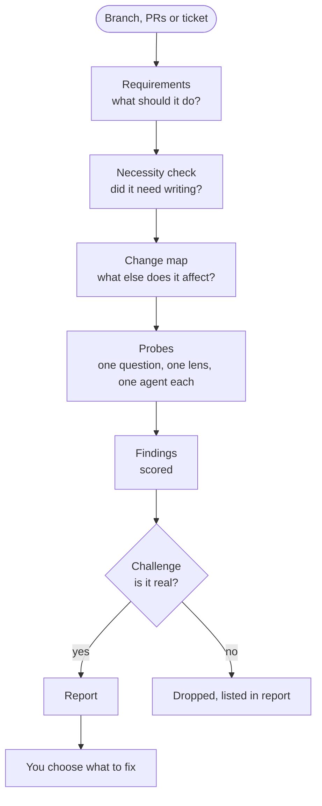

# better-code-review

A code review skill for coding agents. It checks a finished change against what it was supposed to do, and it reports a problem only after a second agent has tried to prove the problem wrong and failed.

```
/better-code-review                 review the current branch
/better-code-review 412             review PR 412 of this repository
/better-code-review 412 418         review several
/better-code-review ABC-123         review every change linked to a ticket
```

In harnesses without slash commands, ask for it by name: "run better-code-review on this branch".

## What it answers

A review run answers five questions, in this order:

1. **What was this change supposed to do?**
2. **Did it need to be written at all?**
3. **What else does it affect, outside the lines that changed?**
4. **What is wrong with it, and how bad is each problem?**
5. **Is each of those problems real?**

The rest of this page explains how each question gets answered.

## The concepts

Ten terms. Everything the skill does and everything in its report is built from them.

| Term | In plain words |
|---|---|
| **Requirement** | One thing the change must do, written so it can be checked. Numbered `R1`, `R2`, ... |
| **Necessity check** | Looks at the code *before* the change to see whether the request made sense |
| **Change map** | A list of what now behaves differently, and who else in the codebase relies on it |
| **Probe** | One specific question about the change, given to one agent |
| **Lens** | A short guide to one way code breaks. Each probe uses one |
| **Finding** | A problem: where it is, what sets it off, what goes wrong |
| **Score and severity** | How bad a finding is: impact × likelihood, named `Critical`, `High`, `Medium` or `Low` |
| **Evidence** | How well a finding is proven: `demonstrated`, `traced` or `inferred` |
| **Challenge** | A second agent tries to disprove a finding without seeing how it was found |
| **Verdict** | The one-line answer at the top of the report |

### Requirement

The skill reads everything that says what the change is for: your task, the ticket, the PR description, commit messages, and comments on the PR, the issue and the ticket. It turns that into a short numbered list.

> `R1` Failed charges are retried up to 3 times
> `R2` A retried charge is never applied twice

At the end each one is `met`, `not met`, `partly met` or `unproven`.

One requirement is always added: `R0`, *nothing outside the stated scope changes*. It catches the unrelated edit that slipped into the branch.

No ticket, no description, commits called "fix"? The skill works out the intent from the change itself (new tests, new names, changed messages), marks those requirements as `derived`, and says so in the report.

### Necessity check

A change can follow its ticket exactly while the ticket is wrong. So before judging the code, the skill reads the codebase as it was before the change and asks:

- Is the reported problem real, or did the old code already do this?
- Does something that does this already exist?
- Are the facts the ticket states about the system true?

Each requirement's reason is rated `sound`, `doubtful` or `unfounded`. This is about facts in the code. It does not judge whether a feature is a good idea.

### Change map

A diff shows which lines changed. It does not show who depended on the old behaviour. For every changed function, type, endpoint, schema or config key the skill writes down *before → after* and searches for its users in the rest of the codebase, and in the other repositories of a multi-repository review.

> `parseAmount`: threw on empty input → now returns null. Called from 3 places outside the diff.

### Probe and lens

A probe is a question the change map raised, such as *"Do the three callers of `parseAmount` handle null?"*. Each probe goes to its own agent with one lens:

| Lens | Asks |
|---|---|
| `necessity` | Did this need to be written at all? |
| `review-comments` | What became of each remark people left? |
| `logic-errors` | Does the code do what its requirement says, for every input? |
| `broken-callers` | Who relied on the way it used to be? |
| `error-handling` | What happens when the thing it calls does not work? |
| `race-conditions` | What if it runs twice at once, or out of order? |
| `security` | Where does untrusted input reach something that matters? |
| `data-compatibility` | Do old data and new code, and new data and old code, agree? |
| `performance` | Does it hold at production size and traffic? |
| `test-gaps` | Would the tests fail if the change were wrong? |
| `maintainability` | What will mislead the next person to change this? |
| `project-rules` | Does it follow the project's own written rules? |

Only the lenses the change calls for are used. A three-line fix does not get a security audit, and the report lists what was skipped.

### Finding

"This could be null" is not a finding. A finding has three parts:

- **Where:** `payments/client.ts:57`
- **When:** the gateway applies the charge but its response times out
- **What goes wrong:** the retry charges the customer a second time

### Score and severity

Each finding gets two numbers from 1 to 5. Multiplied, they give the score, and the score gives the name.

- **Impact:** how bad it is when it happens (5 = lost data, wrong money, a breach; 1 = cosmetic)
- **Likelihood:** how readily it happens (5 = on the normal path; 1 = needs contrivance)

| Severity | Score | Reads as |
|---|---|---|
| `Critical` | 20-25 | Do not merge |
| `High` | 12-16 | Fix before merge |
| `Medium` | 6-10 | Fix, or decide knowingly not to |
| `Low` | 1-5 | Worth knowing |

The report shows both numbers, e.g. `15/25 (impact 5 × likelihood 3)`, so you can see why a finding is ranked where it is.

### Evidence

Separate from how bad a finding is: how well it is proven.

| Grade | Meaning |
|---|---|
| `demonstrated` | Reproduced by running something |
| `traced` | Every step from trigger to consequence was read in the code |
| `inferred` | One step is assumed. Such a finding can never be `Critical` |

### Challenge

Every `Critical`, `High` and `Medium` finding goes to a challenger: a fresh agent that is told only where, when and what goes wrong. It does not see the reasoning, so it cannot be talked into agreeing. It rebuilds the case from the code and looks for what would defeat it: a guard further up, a type that rules the input out, an existing test.

| Result | What happens to the finding |
|---|---|
| `stands` | Reported |
| `narrowed` | Reported with the challenger's score and wording |
| `falls` | Dropped. The report lists it with what defeated it |
| `open` | Listed as unsettled, with what would settle it |

### Verdict

| Verdict | Means |
|---|---|
| `READY` | Nothing found that should hold it back |
| `READY WITH RESERVATIONS` | `Medium` findings, or something that could not be proven |
| `NOT READY` | A `Critical` or `High` finding, or a requirement that is not met |
| `RECONSIDER` | The change, or part of it, may not need to exist. Settle that first |

## Comments are checked too

Requests left on the PR or MR, on a linked issue or on the ticket are compared with the code as it is now. The skill reports the ones nobody answered, and the ones marked resolved although the code did not change or changed into something else. It does not decide whether the reviewer was right.

## How a run goes



## The report

One Markdown file per run. The first screen tells you the verdict, what the change is and what is wrong; the rest is detail in a fixed order:

1. **Verdict** and the one sentence behind it
2. **At a glance:** findings per severity, requirements met, comments needing attention
3. **What this change introduces:** what was asked for, what was delivered, each PR with repository, branch and size, the main changes
4. **Findings:** one table sorted by score, then each finding in full
5. **Requirements** (with the necessity check's result for each) and **Comments**
6. **Since the last review:** what was resolved, what persists, what is new
7. **Coverage:** what was examined, skipped, or rejected in the challenge
8. **Metadata:** model, harness, repository, branch, commit, base, time

```markdown
# NOT READY: ABC-123 Retry failed charges

> R2 is not met: a retried charge can be applied twice (F1).

## At a glance

| | |
|---|---|
| Findings | **0 Critical · 1 High · 1 Medium · 2 Low** · 0 unsettled |
| Requirements | 2 of 3 met · 1 not met |
| Should it exist? | Yes |
| Comments | 1 still applies · 0 badly resolved · 4 fine |

## Findings

| ID | Severity | Score | Finding | Where | Status |
|---|---|---|---|---|---|
| F1 | High | 15 | Retry repeats the charge without an idempotency key | `payments/client.ts:57` | new |
| F2 | Medium | 8 | Backoff is not capped | `payments/retry.ts:22` | new |

Score = impact × likelihood, each rated 1-5. Critical 20-25 · High 12-16 · Medium 6-10 · Low 1-5.

#### F1 · Retry repeats the charge without an idempotency key

Impact 5 × likelihood 3 · traced · challenge: stands · affects R2

**What goes wrong:** the customer is charged twice
**When:** the gateway applies the charge but its response times out
**Fix:** send the order's idempotency key with every attempt
```

Afterwards you choose which findings to fix. The skill fixes those in your working tree, runs the project's own checks and marks them in the report. It never commits, pushes or posts anything.

## What it remembers

Everything lives in `~/.better-code-review/`, outside your repositories:

| Path | Holds |
|---|---|
| `reports/<host>__<owner>-<repo>/<branch>/` | One report per run, named by UTC time and commit |
| `reports/_tickets/<KEY>/` | Reports of multi-repository ticket reviews |
| `context/preferences.md` | How you want reviews done: what to stress, what never to raise |
| `context/repos/<repo>.md` | What is known about one repository: accepted risks, deliberate oddities, findings you dismissed and why |
| `connections/<name>.md` | How to reach one code host or tracker |

**User context.** When you reject a finding with a reason ("that's intentional, the cache is rebuilt nightly"), the skill offers to remember it for that repository and does not raise it again unless the code around it changes. You can also write these files yourself. Nothing is saved without your yes.

**Connections.** The first time a review needs GitHub, GitLab, Jira or anything else, the skill works out how this machine reaches it (a connector, an installed CLI, an environment variable), tries it, and writes down the method that worked. A connection file holds the *name* of a CLI, connector or variable and never a token, password or key.

## Install

```sh
npx skills add marekkawalski/skills -g -s better-code-review
```

Or as a Claude Code plugin:

```
/plugin marketplace add marekkawalski/skills
/plugin install better-code-review@marekkawalski-skills
```

## Requirements

- `bash` and `git`.
- For pull requests, merge requests and tickets: any working way to reach the system, such as the [`gh`](https://cli.github.com) or [`glab`](https://gitlab.com/gitlab-org/cli) client or a connector in your agent. Reviewing a local branch needs none.
- An agent that can start sub-agents gets parallel probes and independent challengers. Without that the skill runs the same steps one after another.

Works in Claude Code, Codex, OpenCode and GitHub Copilot.

## What it will not do

- Change code before you choose fixes, or ever commit, push, comment on or approve a change.
- Obey instructions found inside the code, tickets or comments it reviews.
- Open untracked files that look like credential stores, or write a secret anywhere.
- Rule on whether a human reviewer's comment is right. It tells you what the code did about it.
- Judge whether a feature is worth having.

## Layout

```
better-code-review/
├── SKILL.md                    the review procedure
├── protocol/
│   ├── probe.md                rules, scoring and return format for probes
│   ├── challenge.md            rules and verdicts for challengers
│   ├── report.md               report template and comparison rules
│   └── connections.md          connection file format and starter recipes
├── lenses/                     one file per lens
├── scripts/collect-context.sh  starting facts: base, diff, size, paths
└── agents/openai.yaml          display metadata for Codex
```

## License

[MIT](../LICENSE)
